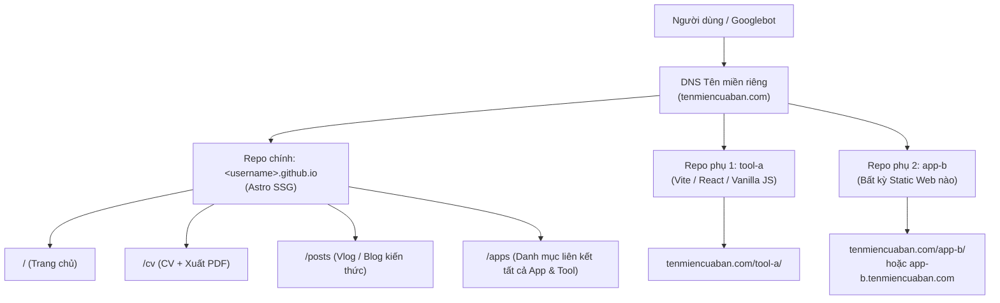

# Kế hoạch Xây dựng Website Cá nhân trên GitHub Pages

Tài liệu này là bản thiết kế kỹ thuật và hướng dẫn triển khai chi tiết để xây dựng hệ thống website cá nhân trên nền tảng **GitHub Pages**, đáp ứng đầy đủ các mục tiêu: **lưu trữ CV**, **viết vlog/blog chia sẻ kiến thức nhanh gọn**, **triển khai các công cụ/web app ở nhiều repo khác nhau**, **chuẩn SEO**, và **sẵn sàng gắn tên miền riêng**.

---

## 0. Giải thích Thuật ngữ & Khái niệm Cốt lõi (Kèm Ví dụ)

Trước khi đi vào chi tiết kỹ thuật, dưới đây là các thuật ngữ xuyên suốt kế hoạch để bạn dễ nắm bắt:

| Thuật ngữ | Giải thích dễ hiểu | Ví dụ thực tế trong dự án |
| :--- | :--- | :--- |
| **Repository (Repo) & Multi-Repo** | *Repo* là một "thư mục dự án" lưu trên GitHub. *Multi-Repo* nghĩa là tách nhiều dự án ra các repo riêng thay vì dồn hết vào 1 chỗ. | Repo `tenban.github.io` chứa trang chủ, CV, vlog. Repo `tool-json` riêng chứa công cụ định dạng JSON. |
| **Static Site (Web tĩnh) & SSG** | Web tĩnh chỉ gồm các file HTML, CSS, JS dựng sẵn — không cần server backend chạy ngầm. *SSG (Static Site Generation)* là công cụ biên dịch sẵn dữ liệu thành HTML trước khi đưa lên mạng. | Khi build, Astro đọc file bài viết `docker.mdx` và xuất ra sẵn file `posts/docker/index.html` để trình duyệt và Google đọc ngay. |
| **GitHub Pages** | Dịch vụ lưu trữ (hosting) web tĩnh miễn phí của GitHub, cho phép biến code trong repo thành trang web truy cập công khai. | Đẩy code lên repo `tenban.github.io` $\rightarrow$ xem được ngay tại `https://tenban.github.io`. |
| **GitHub Actions (CI/CD)** | "Robot tự động" của GitHub chạy theo kịch bản định sẵn mỗi khi bạn đẩy code mới (`git push`). | Bạn viết xong 1 bài vlog rồi push lên GitHub $\rightarrow$ GitHub Actions tự cài thư viện, build HTML và cập nhật trang web sau ~1 phút. |
| **File `.astro`, Layout & `<slot />`** | Định dạng file giao diện của Astro gồm 2 phần: phần `--- ... ---` xử lý dữ liệu lúc build (không gửi xuống trình duyệt) và phần HTML bên dưới. `<slot />` là "ô trống" trong Layout để lồng nội dung trang con vào. | `BaseLayout.astro` chứa sẵn Header + `<slot />` + Footer. Trang `cv.astro` chỉ cần bọc trong `<BaseLayout>`, nội dung CV sẽ tự chui vào đúng vị trí `<slot />`. |
| **Markdown (`.md`), MDX (`.mdx`) & Frontmatter** | *Markdown* là cách viết văn bản định dạng nhanh bằng ký hiệu (`#` là tiêu đề, `**chữ**` là in đậm). *MDX* cho phép nhúng thêm component tương tác vào Markdown. *Frontmatter* là khối khai báo thông tin ở đầu bài (nằm giữa `---`). | Đầu bài viết khai báo `title`, `pubDate`, `youtubeId`; bên dưới viết chữ bình thường và chèn `<YouTubeEmbed />` hoặc `<Callout />`. |
| **Content Collections & Schema** | Hệ thống quản lý bài viết theo cấu trúc chặt chẽ của Astro. *Schema* là bộ quy tắc kiểm tra xem bài viết có điền đủ thông tin bắt buộc hay chưa. | Nếu bạn quên viết `description` (mô tả SEO) trong một bài vlog, lúc build Astro sẽ báo lỗi nhắc ngay. |
| **Subpath vs. Subdomain & `base` path** | *Subpath* là nhánh con sau dấu `/`; *Subdomain* là tên miền phụ đứng trước dấu `.`. `base` path là thư mục gốc cấu hình trong code để web biết chỗ tải CSS/JS. | Subpath: `domain.com/tool-a/` (cần đặt `base: '/tool-a/'`). Subdomain: `tool-a.domain.com` (dùng `base: '/'`). |
| **SEO, Canonical URL, Open Graph & JSON-LD** | *SEO* giúp Google xếp hạng trang tốt. *Canonical URL* báo Google biết đâu là link gốc duy nhất. *Open Graph (OG)* tạo ảnh/tiêu đề đẹp khi gửi link qua Zalo/Facebook. *JSON-LD* là đoạn mã dữ liệu có cấu trúc giúp Google hiểu bản chất trang. | Bài vlog có JSON-LD `BlogPosting` + `VideoObject` giúp Google Search hiển thị kèm ngày đăng, tác giả và video preview. |
| **Sitemap & `robots.txt`** | `sitemap-index.xml` là bản đồ liệt kê toàn bộ link trên web. `robots.txt` là file chỉ dẫn cho bot tìm kiếm biết được phép đọc phần nào. | `robots.txt` chứa dòng `Sitemap: https://domain.com/sitemap-index.xml` để Googlebot tự động tìm thấy bài viết mới. |
| **DNS, Bản ghi `A` & `CNAME`** | Hệ thống phân giải tên miền giúp chuyển tên miền chữ thành địa chỉ máy chủ GitHub. Bản ghi `A` trỏ về địa chỉ IP; `CNAME` trỏ tên miền này sang tên miền khác. | Trỏ bản ghi `A` của `domain.com` về 4 IP của GitHub Pages; trỏ `CNAME` của `www` về `tenban.github.io`. |

---

## 1. Kiến trúc tổng thể (Multi-Repo dưới một Tên miền duy nhất)

Bạn không cần dồn toàn bộ mã nguồn vào chung 1 repository mới dùng chung được 1 tên miền. **GitHub Pages hỗ trợ tự nhiên mô hình Multi-Repo**:

* **Repo chính (`<username>.github.io`)**: Chứa trang chủ, CV, hệ thống bài viết (vlog/blog), và trang danh mục tổng hợp tất cả công cụ/app. Khi gắn tên miền riêng (ví dụ `tenmiencuaban.com`), repo này phục vụ tại gốc `/`.
* **Các Repo phụ (`tool-json`, `app-pomodoro`, v.v.)**: Mỗi công cụ hoặc web app độc lập có thể đặt ở repo riêng, viết bằng bất kỳ công nghệ nào. Khi bật GitHub Pages cho repo phụ:
  * **Cách A (Subpath — Tự động, không cần cấu hình DNS thêm):** GitHub Pages tự động gắn repo phụ vào dưới tên miền chính tại `https://tenmiencuaban.com/tool-json/`.
  * **Cách B (Subdomain — Tùy chọn khi muốn tách biệt hẳn):** Tạo bản ghi `CNAME` trong DNS để trỏ `json.tenmiencuaban.com` về `<username>.github.io` và thêm file `CNAME` vào repo phụ đó.



---

## 2. Lựa chọn Công nghệ (Tech Stack)

### 2.1. Công nghệ cho Repo chính: **Astro + Tailwind CSS + MDX**

| Thành phần | Lựa chọn đề xuất | Lý do lựa chọn |
| :--- | :--- | :--- |
| **Framework** | **Astro** (Static Site Generation) | Xuất ra HTML/CSS thuần, gần như **0 KB JavaScript** mặc định $\rightarrow$ Tốc độ tải cực nhanh, đạt điểm Core Web Vitals tối đa, **Googlebot đọc được nội dung ngay lập tức (chuẩn SEO)**. |
| **Định dạng bài viết** | **Markdown (`.md`) & MDX (`.mdx`)** | Viết bài nhanh như ghi chú, nhưng vẫn nhúng được component tương tác (video YouTube tối ưu tải, hộp cảnh báo, demo code) khi cần. |
| **Quản lý nội dung** | **Astro Content Collections** | Kiểm tra tự động các trường metadata (tiêu đề, mô tả SEO, ngày đăng, ảnh bìa) bằng schema TypeScript/Zod — tránh quên thẻ SEO trước khi deploy. |
| **Styling** | **Tailwind CSS** + `@tailwindcss/typography` | Thiết kế giao diện sạch, responsive, tự động định dạng đẹp cho bài viết Markdown dài và hỗ trợ in ấn (`print:`) cho trang CV. |
| **Hiển thị Code** | **Expressive Code / Shiki** (tích hợp sẵn) | Tự động tô màu cú pháp chuẩn IDE, có nút Copy, đánh số dòng, highlight dòng thay đổi, hiển thị tên file. |
| **Công cụ nhỏ nội bộ** | **Astro Islands** (React / Svelte / Vanilla JS) | Nếu có các tool nhỏ (như máy tính, chuyển đổi đơn vị) muốn đặt ngay trong repo chính, Astro chỉ tải JS ở đúng vùng chứa tool đó. |
| **Tìm kiếm bài viết** | **Pagefind** | Công cụ tìm kiếm tĩnh 100% không cần server/database, tự quét HTML sau khi build và chỉ tải index nhỏ gọn khi người dùng gõ tìm kiếm. |
| **Bình luận (Tùy chọn)** | **Giscus** | Lưu bình luận trên GitHub Discussions của repo — hoàn toàn miễn phí, không quảng cáo, hợp với trang kỹ thuật. |

> **Tại sao không dùng React/Vue SPA thuần (Vite) cho Repo chính?**
> Website SPA truyền thống render giao diện bằng JavaScript ở trình duyệt, khiến file HTML ban đầu gần như rỗng — không tối ưu cho SEO bài viết và chia sẻ link lên Facebook/Zalo/LinkedIn (dễ bị mất ảnh preview/tiêu đề). Astro giải quyết triệt để vấn đề này vì toàn bộ trang được dựng sẵn thành HTML tĩnh khi build.

### 2.2. Công nghệ cho các Repo Công cụ / Web App phụ

Vì tách repo độc lập, bạn hoàn toàn tự do chọn stack phù hợp nhất với từng app:

* **Tool đơn giản:** HTML + CSS + Vanilla JS (không cần bước build).
* **Web App tương tác phức tạp:** Vite + React / Vue / TypeScript + Tailwind CSS.
* **App xử lý nặng phía client (ảnh, PDF, thuật toán):** WebAssembly (Wasm), Web Workers, lưu dữ liệu người dùng bằng `localStorage` hoặc `IndexedDB` (không tốn chi phí server).

---

## 3. Cấu trúc Thư mục & Bảng Tra cứu Cấu hình Giao diện

### 3.1. Cấu trúc thư mục Repo chính (`<username>.github.io`)

```text
website-gitpages/
├── .github/
│   └── workflows/
│       └── deploy.yml              # Tự động build & deploy lên GitHub Pages
├── public/
│   ├── CNAME                       # File chứa tên miền riêng (thêm khi gắn domain)
│   ├── robots.txt                  # Chỉ dẫn cho Googlebot & trỏ tới sitemap
│   ├── favicon.svg                 # Biểu tượng trang web
│   └── files/
│       └── cv-cua-toi.pdf          # (Tùy chọn) Bản PDF tĩnh nếu muốn cho tải trực tiếp
├── scripts/
│   └── new-post.mjs                # Script tạo nhanh bài vlog/blog theo template
├── src/
│   ├── styles/
│   │   └── global.css              # CSS tổng, biến màu Dark/Light, quy tắc @media print
│   ├── components/
│   │   ├── seo/
│   │   │   ├── BaseHead.astro      # Meta tags, Open Graph, Canonical URL
│   │   │   └── JsonLd.astro        # Structured Data (Person, BlogPosting, WebApp)
│   │   ├── mdx/
│   │   │   ├── YouTubeEmbed.astro  # Nhúng video YouTube nhẹ (chỉ tải iframe khi bấm)
│   │   │   ├── Callout.astro       # Hộp Lưu ý / Mẹo / Cảnh báo trong bài viết
│   │   │   └── ImageCaption.astro  # Ảnh kèm chú thích & tối ưu kích thước
│   │   ├── Header.astro            # Thanh điều hướng (Trang chủ, Vlog, CV, Công cụ)
│   │   ├── Footer.astro            # Chân trang (bản quyền, social links, RSS)
│   │   ├── PostCard.astro          # Thẻ tóm tắt bài viết (dùng ở Trang chủ & /posts)
│   │   └── AppCard.astro           # Thẻ trưng bày công cụ/app (dùng ở Trang chủ & /apps)
│   ├── content/
│   │   ├── config.ts               # Định nghĩa Schema kiểm tra dữ liệu bài viết
│   │   └── posts/                  # Thư mục chứa toàn bộ bài vlog/blog
│   │       └── 2026-11-16-bai-dau-tien/
│   │           ├── index.mdx       # Nội dung bài viết
│   │           └── cover.png       # Ảnh nằm ngay cạnh bài viết -> dễ quản lý
│   ├── data/
│   │   ├── profile.ts              # Thông tin chung (tên, bio, social links, domain)
│   │   ├── cv.yaml                 # Toàn bộ dữ liệu CV (kinh nghiệm, học vấn, kỹ năng)
│   │   └── apps.json               # Danh sách các Web App / Tool (cả nội bộ & khác repo)
│   ├── layouts/
│   │   ├── BaseLayout.astro        # Khung chung toàn trang (Header + <slot /> + Footer)
│   │   └── PostLayout.astro        # Khung bài viết (Mục lục TOC, bài liên quan, JSON-LD)
│   └── pages/
│       ├── index.astro             # Trang chủ (/)
│       ├── cv.astro                # Trang CV (/cv)
│       ├── apps.astro              # Trang Công cụ & Web Apps (/apps)
│       ├── rss.xml.ts              # Xuất RSS Feed tự động
│       └── posts/
│           ├── index.astro         # Danh sách tất cả bài viết + lọc theo Tag
│           └── [...slug].astro     # Trang chi tiết từng bài viết
├── astro.config.mjs                # Cấu hình domain (site), tích hợp Sitemap, MDX, Code theme
├── package.json
└── tailwind.config.mjs             # Bảng màu thương hiệu, font chữ, cấu hình typography
```

### 3.2. Tra cứu nhanh: Muốn sửa Giao diện phần nào thì mở File nào?

| Bạn muốn thay đổi | File cần mở |
| :--- | :--- |
| Màu chủ đạo, font chữ, kích thước chữ bài viết | `tailwind.config.mjs` (hoặc `@theme` trong `src/styles/global.css` nếu dùng Tailwind v4) |
| Màu nền Dark/Light mode, style in CV (A4) | `src/styles/global.css` |
| Theme màu của khối Code (GitHub Dark, Dracula...) | `astro.config.mjs` (mục `markdown.shikiConfig` hoặc Expressive Code) |
| Khung lề tổng thể toàn web | `src/layouts/BaseLayout.astro` |
| Menu trên cùng, Logo, nút đổi Dark/Light | `src/components/Header.astro` |
| Chân trang, link mạng xã hội | `src/components/Footer.astro` |
| Giao diện Trang chủ / CV / Vlog / Apps | File tương ứng trong `src/pages/` và `src/layouts/PostLayout.astro` |
| Nội dung thông tin cá nhân / CV / Danh sách App | `src/data/profile.ts`, `src/data/cv.yaml`, `src/data/apps.json` (sửa dữ liệu, không cần sửa HTML) |

---

## 4. Hướng dẫn Build Chi tiết Từng Phần của Trang Web

Mục này mô tả cụ thể bố cục, file dữ liệu và từng bước xây dựng cho **5 phân hệ** của website để có thể bắt tay vào code ngay.

### 4.1. Phân hệ 0: Khung sườn dùng chung (`BaseLayout` + `SEO` + `Style`)

Mọi trang (`/`, `/cv`, `/posts`, `/apps`) đều dùng chung một bộ khung để đồng bộ giao diện và không lặp lại code.

* **Các bước xây dựng:**
  1. **Tạo `src/data/profile.ts`:** Lưu thông tin tĩnh toàn trang (tên hiển thị, nghề nghiệp, mô tả SEO mặc định, email, link GitHub/YouTube/LinkedIn, đường dẫn menu điều hướng).
  2. **Thiết lập `src/styles/global.css` & `tailwind.config.mjs`:**
     * Định nghĩa font chữ (ví dụ: `Inter` cho văn bản, `JetBrains Mono` cho code).
     * Định nghĩa biến màu CSS cho Light/Dark mode (lưu lựa chọn của người dùng vào `localStorage`).
     * Thêm quy tắc `@media print` để phục vụ xuất PDF ở trang CV.
  3. **Tạo `src/components/seo/BaseHead.astro`:** Nhận `title`, `description`, `image` từ từng trang $\rightarrow$ tự sinh `<title>`, `<meta name="description">`, `<link rel="canonical">`, các thẻ `og:*` và `twitter:*`.
  4. **Tạo `src/components/Header.astro` & `Footer.astro`:**
     * `Header`: Logo/Tên bên trái; menu link (*Trang chủ, Vlog, Công cụ, CV*) + nút đổi Dark/Light + nút menu mobile (`<details>` hoặc JS nhỏ) bên phải.
     * `Footer`: Bản quyền, liên kết nhanh, link `rss.xml`.
  5. **Gom vào `src/layouts/BaseLayout.astro`:** Bố cục `<head><BaseHead /></head><body><Header /><main><slot /></main><Footer /></body>`.

---

### 4.2. Phân hệ 1: Trang chủ (`/`) — `src/pages/index.astro`

* **Mục tiêu:** Trong 5 giây đầu tiên, người đọc (hoặc nhà tuyển dụng) hiểu bạn là ai, làm gì, xem được ngay CV, các bài chia sẻ mới nhất và sản phẩm nổi bật.
* **Bố cục đề xuất (Wireframe):**

```text
+-------------------------------------------------------------------+
| [Logo/Tên]                Vlog   Công cụ   CV   [Tìm kiếm] [Dark] |
+-------------------------------------------------------------------+
|  (Ảnh Avatar)   Xin chào, tôi là <Tên của bạn>                    |
|                 <Chức danh / Câu giới thiệu ngắn 1-2 dòng>        |
|                 [ Xem CV của tôi ]   [ Khám phá Công cụ ]         |
+-------------------------------------------------------------------+
|  BÀI VIẾT & VLOG MỚI NHẤT                            Xem tất cả ->|
|  +------------------------+  +------------------------+           |
|  | [Ảnh] Tiêu đề bài 1    |  | [Ảnh] Tiêu đề bài 2    |           |
|  | Mô tả ngắn + Tag       |  | Mô tả ngắn + Tag       |           |
|  +------------------------+  +------------------------+           |
+-------------------------------------------------------------------+
|  CÔNG CỤ & APP NỔI BẬT                               Xem tất cả ->|
|  +------------------------+  +------------------------+           |
|  | Tên Tool 1   [Mở App]  |  | Tên Tool 2   [Mở App]  |           |
|  +------------------------+  +------------------------+           |
+-------------------------------------------------------------------+
|  © 2026 Tên của bạn • GitHub • LinkedIn • YouTube • RSS           |
+-------------------------------------------------------------------+
```

* **Các bước build cụ thể cho Trang chủ:**
  1. **Lấy dữ liệu đầu vào (trong khối `--- ... ---` của `src/pages/index.astro`):**
     * Đọc thông tin giới thiệu từ `src/data/profile.ts`.
     * Gọi `getCollection('posts')`, lọc bỏ bài đang nháp (`!post.data.draft`), sắp xếp theo `pubDate` giảm dần và cắt lấy **3–4 bài mới nhất** (`.slice(0, 4)`).
     * Đọc `src/data/apps.json`, lọc các mục có `featured: true` (lấy **2–4 app nổi bật**).
  2. **Dựng 3 khối giao diện chính bên dưới `---`:**
     * **Khối 1 — Hero Section:** Ảnh đại diện (`<Image />` tối ưu sẵn), thẻ `<h1>` duy nhất của trang chủ, đoạn giới thiệu ngắn, 2 nút CTA chính dẫn tới `/cv` và `/apps`, kèm các icon mạng xã hội.
     * **Khối 2 — Bài viết & Vlog mới nhất:** Dùng lưới CSS (`grid grid-cols-1 md:grid-cols-2 gap-6`) lặp qua danh sách bài vừa lọc và render bằng component `<PostCard post={post} />`.
     * **Khối 3 — Công cụ & App nổi bật:** Lặp qua danh sách app nổi bật và render bằng `<AppCard app={app} />`.
  3. **Gắn SEO cho Trang chủ:** Truyền `JsonLd` kiểu `Person` (khai báo tên, nghề nghiệp, link GitHub/LinkedIn) vào `<BaseLayout>`.

* **Khung code minh họa cho `src/pages/index.astro`:**

```astro
---
import BaseLayout from '@/layouts/BaseLayout.astro';
import PostCard from '@/components/PostCard.astro';
import AppCard from '@/components/AppCard.astro';
import JsonLd from '@/components/seo/JsonLd.astro';
import { profile } from '@/data/profile';
import apps from '@/data/apps.json';
import { getCollection } from 'astro:content';

const latestPosts = (await getCollection('posts', ({ data }) => !data.draft))
  .sort((a, b) => b.data.pubDate.valueOf() - a.data.pubDate.valueOf())
  .slice(0, 4);

const featuredApps = apps.filter((app) => app.featured).slice(0, 4);
---

<BaseLayout title={profile.siteTitle} description={profile.bio}>
  <JsonLd type="Person" slot="head" />

  <!-- 1. Hero Section -->
  <section class="py-12 border-b">
    <h1 class="text-3xl font-bold">{profile.name}</h1>
    <p class="mt-3 text-lg text-gray-600">{profile.bio}</p>
    <div class="mt-6 flex gap-4">
      <a href="/cv" class="btn-primary">Xem CV</a>
      <a href="/apps" class="btn-secondary">Công cụ & App</a>
    </div>
  </section>

  <!-- 2. Bài viết / Vlog mới -->
  <section class="py-10">
    <div class="flex justify-between items-center mb-6">
      <h2 class="text-2xl font-semibold">Vlog & Bài viết mới</h2>
      <a href="/posts">Xem tất cả →</a>
    </div>
    <div class="grid grid-cols-1 md:grid-cols-2 gap-6">
      {latestPosts.map((post) => <PostCard post={post} />)}
    </div>
  </section>

  <!-- 3. Công cụ nổi bật -->
  <section class="py-10">
    <div class="flex justify-between items-center mb-6">
      <h2 class="text-2xl font-semibold">Công cụ & App nổi bật</h2>
      <a href="/apps">Xem tất cả →</a>
    </div>
    <div class="grid grid-cols-1 md:grid-cols-2 gap-6">
      {featuredApps.map((app) => <AppCard app={app} />)}
    </div>
  </section>
</BaseLayout>
```

---

### 4.3. Phân hệ 2: Trang CV (`/cv`) — `src/pages/cv.astro` + `src/data/cv.yaml`

* **Mục tiêu:** Hiển thị CV chuyên nghiệp trên web, dễ cập nhật thông tin, và **xuất thẳng ra PDF chuẩn A4** chỉ bằng 1 nút bấm mà không phải sửa 2 bản riêng biệt.
* **Bố cục đề xuất:**
  * **Thanh công cụ trên cùng (`print:hidden`):** Nút *"In / Lưu thành PDF"* (gọi `window.print()`) và link tải bản PDF dự phòng (nếu có).
  * **Khối Header CV:** Họ tên (`<h1>`), Vị trí ứng tuyển, Email, SĐT (hoặc link liên hệ), GitHub, Website.
  * **Tóm tắt bản thân (Summary):** 3–4 dòng nêu thế mạnh cốt lõi.
  * **Kinh nghiệm làm việc (Experience):** Tên công ty, vị trí, thời gian, 3–4 gạch đầu dòng thành tích (có số liệu cụ thể).
  * **Dự án tiêu biểu (Projects):** Liên kết trực tiếp sang các web app/repo của bạn.
  * **Kỹ năng (Skills):** Nhóm theo danh mục (Ngôn ngữ, Framework, Công cụ/DevOps).
  * **Học vấn & Chứng chỉ (Education & Certifications).**

* **Các bước build cụ thể:**
  1. **Tạo file dữ liệu `src/data/cv.yaml`** (cài gói `js-yaml` hoặc import qua plugin YAML để Astro đọc thành object):

     ```yaml
     name: "Nguyễn Văn A"
     role: "Software Engineer"
     email: "email@domain.com"
     summary: "Mô tả ngắn..."
     skills:
       - group: "Frontend & Web"
         items: ["TypeScript", "Astro", "React", "Tailwind CSS"]
     experience:
       - company: "Công ty X"
         role: "Frontend Developer"
         period: "2024 - Hiện tại"
         highlights:
           - "Xây dựng hệ thống Y giúp giảm 30% thời gian tải trang."
     ```

  2. **Xây dựng `src/pages/cv.astro`:** Đọc `cv.yaml`, lặp các mảng `experience`, `projects`, `skills`, `education` để render HTML ngữ nghĩa (`<section>`, `<article>`, `<ul>`).
  3. **Cấu hình in PDF chuẩn A4 trong `src/styles/global.css`:**
     * Dùng class `print:hidden` của Tailwind cho `Header`, `Footer` và nút bấm trên web.
     * Đặt `@page { size: A4; margin: 12mm; }` và `break-inside: avoid` cho mỗi khối kinh nghiệm/dự án để máy in/PDF không cắt đôi một mục giữa 2 trang.
  4. **Gắn SEO:** `JsonLd` kiểu `Person` + `ProfilePage`.

---

### 4.4. Phân hệ 3: Hệ thống Vlog & Blog (`/posts` & `/posts/[slug]`)

Hệ thống này gồm **2 loại trang** và **1 bộ công cụ tạo bài nhanh**:

1. **Trang Danh sách bài viết (`/posts` — `src/pages/posts/index.astro`):**
   * **Bố cục:** Tiêu đề trang $\rightarrow$ Thanh tìm kiếm (Pagefind) $\rightarrow$ Danh sách các nút lọc theo Tag (`#all`, `#vlog`, `#devops`, `#javascript`...) $\rightarrow$ Lưới các thẻ `PostCard.astro` (mỗi thẻ hiện ảnh cover, badge "Vlog" nếu có `youtubeId`, ngày đăng, tiêu đề, mô tả, tags).
   * **Cách build:** Lấy toàn bộ bài từ `getCollection('posts')` (lọc `draft: false`), sắp xếp mới nhất lên đầu. Tạo thêm trang lọc theo từng tag (`/posts/tags/[tag].astro`) hoặc dùng JS nhỏ lọc trực tiếp tại trang `/posts` cho mượt.

2. **Trang Chi tiết bài viết (`/posts/[...slug]` — `src/pages/posts/[...slug].astro` + `src/layouts/PostLayout.astro`):**
   * **Bố cục:**
     * Breadcrumb (`Trang chủ > Bài viết > Tên bài`)
     * Phần đầu bài: `<h1>` Tiêu đề, ngày đăng, ngày cập nhật, thời gian đọc ước tính, danh sách Tags.
     * Nếu có `youtubeId`: Hiển thị trình phát `YouTubeEmbed.astro` ngay đầu bài (để xem như Vlog).
     * Thân bài chia 2 cột trên màn hình lớn: Cột trái (70–75%) là nội dung bài viết (văn bản, ảnh tối ưu, khung code, callout); Cột phải (25–30%) là **Mục lục (TOC)** tự động bám theo vị trí cuộn trang (`sticky`).
     * Cuối bài: Hộp gợi ý 2–3 bài liên quan cùng Tag + Khung bình luận (Giscus — tùy chọn).
   * **Các bước build cụ thể:**
     1. Khai báo schema kiểm tra dữ liệu bài viết trong `src/content/config.ts`.
     2. Trong `src/pages/posts/[...slug].astro`, viết hàm `getStaticPaths()` để Astro tự quét toàn bộ thư mục `src/content/posts/` và sinh một trang HTML riêng cho từng bài.
     3. Gọi `const { Content, headings } = await post.render();` — biến `headings` chứa sẵn danh sách các thẻ `H2, H3` để dựng Mục lục (TOC) tự động mà không cần thư viện ngoài.
     4. Xây dựng 3 component MDX tái sử dụng (`YouTubeEmbed.astro`, `Callout.astro`, `ImageCaption.astro`) để dùng trong mọi bài viết.
     5. Gắn `JsonLd` kiểu `BlogPosting` (và thêm `VideoObject` nếu bài có `youtubeId`) + `BreadcrumbList`.

---

### 4.5. Phân hệ 4: Trang Công cụ & Web Apps (`/apps`) — `src/pages/apps.astro` + `src/data/apps.json`

* **Mục tiêu:** Là "cổng tổng hợp" giới thiệu và dẫn link tới tất cả công cụ bạn viết — dù công cụ đó nằm ngay trong repo chính hay nằm ở các repo GitHub tách biệt.
* **Bố cục:** Thanh phân loại nhanh (Tất cả / Tiện ích nhỏ / Web App) $\rightarrow$ Lưới các thẻ `AppCard.astro` gồm: Ảnh preview, Tên app, Nhãn trạng thái (*Live*, *Beta*), Mô tả ngắn công dụng, Tag công nghệ, Nút **"Mở công cụ"** và nút **"Mã nguồn (GitHub)"**.

* **Mẫu cấu trúc `src/data/apps.json` (hỗ trợ cả Nội bộ & Đa Repo):**

```json
[
  {
    "id": "pomodoro-timer",
    "name": "Pomodoro Tập Trung",
    "description": "Đồng hồ đếm ngược Pomodoro kèm âm thanh nền chạy offline.",
    "url": "/tools/pomodoro",
    "repoUrl": "https://github.com/<username>/<username>.github.io",
    "locationType": "internal",
    "tags": ["Astro", "Vanilla JS"],
    "featured": true,
    "thumbnail": "/images/apps/pomodoro.png"
  },
  {
    "id": "json-formatter",
    "name": "JSON Formatter & Diff",
    "description": "Công cụ làm đẹp, kiểm tra lỗi và so sánh 2 file JSON ngay trên trình duyệt.",
    "url": "/tool-json/",
    "repoUrl": "https://github.com/<username>/tool-json",
    "locationType": "subpath-repo",
    "tags": ["React", "TypeScript", "Vite"],
    "featured": true,
    "thumbnail": "/images/apps/json-tool.png"
  }
]
```

* **Các bước build & kết nối 1 Repo App mới vào trang:**
  1. Tạo repo mới trên GitHub (ví dụ `tool-json`), code app bằng công nghệ tùy chọn.
  2. Trong file cấu hình build của repo đó (như `vite.config.ts`), đặt `base: '/tool-json/'`.
  3. Bật GitHub Pages cho repo `tool-json` (deploy bằng GitHub Actions hoặc nhánh `gh-pages`). Khi chạy xong, app tự động truy cập được ở `https://tenmiencuaban.com/tool-json/`.
  4. Quay lại repo chính, thêm 1 khối JSON vào `src/data/apps.json` và `git push` $\rightarrow$ Trang `/apps` (và Trang chủ nếu `featured: true`) tự động cập nhật thẻ công cụ mới.

---

## 5. Giải pháp Viết Vlog / Blog Nhanh gọn (Không viết lại mã)

Để việc đăng bài mới chỉ tốn vài giây thiết lập và tập trung hoàn toàn vào nội dung (chữ, ảnh, code, video), kế hoạch đề xuất quy trình gồm 3 lớp:

### 5.1. Dùng Script sinh Template tự động (`npm run new-post`)

Bạn gõ một lệnh duy nhất trong terminal:

```bash
npm run new-post "Huong dan Docker co ban"
```

Script `scripts/new-post.mjs` sẽ tự động:

1. Chuyển tên bài thành slug chuẩn SEO không dấu (`2026-11-16-huong-dan-docker-co-ban`).
2. Tạo thư mục riêng `src/content/posts/2026-11-16-huong-dan-docker-co-ban/` để ảnh và bài viết đi cùng nhau, không bao giờ bị thất lạc.
3. Tạo sẵn file `index.mdx` với đầy đủ khung mẫu:

````mdx
---
title: "Hướng dẫn Docker cơ bản cho người mới"
description: "Tóm tắt ngắn 140-160 ký tự hiển thị trên Google Search."
pubDate: 2026-11-16
updatedDate: 2026-11-16
tags: ["docker", "devops"]
youtubeId: ""          # Điền ID video nếu là bài Vlog (vd: dQw4w9WgXcQ), để trống nếu chỉ có chữ
draft: true            # Đặt false khi sẵn sàng xuất bản công khai
cover: "./cover.png"   # Ảnh đại diện bài viết & ảnh share mạng xã hội
---
import YouTubeEmbed from '@/components/mdx/YouTubeEmbed.astro';
import Callout from '@/components/mdx/Callout.astro';

{/* Xóa dòng dưới nếu không có video */}
<YouTubeEmbed id={frontmatter.youtubeId} title={frontmatter.title} />

## 1. Giới thiệu vấn đề

Viết nội dung văn bản tự nhiên bằng Markdown tại đây...

<Callout type="tip" title="Mẹo nhanh">
  Nội dung ghi chú nổi bật cho người đọc.
</Callout>

## 2. Chèn ảnh & Code minh họa


```bash title="docker-run.sh"
docker run -d -p 8080:80 nginx
```
````

### 5.2. Tăng tốc nhập liệu trong VS Code (Snippets + Dán ảnh trực tiếp)

* **Dán ảnh trực tiếp (`Ctrl + V`):** Bật tính năng *Markdown Image Copy/Paste* có sẵn của VS Code (cài đặt `markdown.copyFiles.destination` lưu vào cùng thư mục bài viết) $\rightarrow$ Chụp màn hình hoặc copy ảnh rồi dán thẳng vào file `.mdx`, VS Code tự lưu file ảnh và chèn sẵn thẻ ``.
* **VS Code Snippets (`.vscode/blog.code-snippets`):** Tạo sẵn các phím tắt như gõ `vlog-code`, `vlog-callout`, `vlog-yt` rồi bấm `Tab` để chèn nhanh khung code hoặc video.

### 5.3. Nâng cấp tùy chọn (Giai đoạn sau): Viết bài qua giao diện Web (CMS)

Nếu bạn muốn viết bài từ điện thoại hoặc trình duyệt mà không cần mở VS Code/Git, có thể gắn thêm **Pages CMS** hoặc **Sveltia CMS** (miễn phí, mã nguồn mở, không cần server riêng). Công cụ này đăng nhập bằng tài khoản GitHub của bạn, cung cấp trình soạn thảo giống Word/Notion, kéo thả ảnh vào là tự tạo commit lên GitHub để web tự cập nhật.

---

## 6. Chiến lược Chuẩn SEO Toàn diện

Để Google tìm kiếm nhận diện tốt, xếp hạng cao và hiển thị đẹp khi chia sẻ link:

1. **HTML Tĩnh & Semantic HTML:**
   * Sử dụng đúng thẻ ngữ nghĩa (`<header>`, `<main>`, `<article>`, `<nav>`, `<time datetime="...">`).
   * Mỗi trang chỉ có **duy nhất 1 thẻ `<h1>`**, các mục con phân cấp chặt chẽ `<h2>` $\rightarrow$ `<h3>`.
2. **Metadata & Canonical URL (`BaseHead.astro`):**
   * Tự động sinh `<title>` (`Tên bài viết | Tên thương hiệu`), `<meta name="description">`, `<link rel="canonical" href="...">` (tránh lỗi trùng lặp nội dung giữa `<username>.github.io` và tên miền riêng).
   * Đầy đủ thẻ **Open Graph (`og:title`, `og:description`, `og:image`, `og:type`)** và **Twitter Card** để khi gửi link lên Facebook, Zalo, LinkedIn có ảnh preview sắc nét.
3. **Structured Data (JSON-LD) giúp Google hiểu ngữ cảnh:**
   * Trang chủ & Trang CV: Schema `Person` / `ProfilePage`.
   * Mỗi bài Vlog/Blog: Schema `BlogPosting` (Tiêu đề, tác giả, ngày đăng, ngày cập nhật, ảnh bìa) + `BreadcrumbList`.
   * Nếu bài viết có video: Bổ sung Schema `VideoObject` để Google Search có thể hiển thị ở tab Video.
   * Trang Công cụ: Schema `WebApplication` / `SoftwareApplication`.
4. **Hệ thống lập chỉ mục tự động:**
   * Dùng `@astrojs/sitemap` tạo tự động `sitemap-index.xml` mỗi lần build.
   * File `public/robots.txt` cho phép bot index và khai báo thẳng đường dẫn Sitemap (`Sitemap: https://tenmiencuaban.com/sitemap-index.xml`).
   * Xuất `rss.xml` giúp độc giả hoặc các trang tổng hợp theo dõi bài mới tự động.
5. **Tối ưu Tốc độ & Core Web Vitals (Yếu tố xếp hạng của Google):**
   * Mọi ảnh bài viết xử lý qua `astro:assets` $\rightarrow$ tự động nén sang định dạng `.webp`/`.avif`, tự gắn `width`/`height` chống giật bố cục (CLS = 0) và bật `loading="lazy"`.
   * Video YouTube **không nhúng `<iframe>` nặng nề ngay từ đầu** (gây tụt điểm PageSpeed ~20–30 điểm), mà dùng component `YouTubeEmbed` hiển thị ảnh thumbnail nhẹ; chỉ khi người dùng bấm nút Play mới tải trình phát YouTube.
6. **Quy trình đăng ký với Google:**
   * Sau khi gắn tên miền, xác minh quyền sở hữu trên **Google Search Console** (bằng bản ghi TXT trong DNS), gửi đường dẫn `sitemap-index.xml`, và theo dõi các từ khóa người dùng tìm thấy bạn.

---

## 7. Xử lý Triển khai Đa Repo & Thiết lập Tên miền riêng

### 7.1. Tự động Deploy Repo chính bằng GitHub Actions

Thay vì chỉ push file HTML thủ công, tạo file `.github/workflows/deploy.yml` dùng `withastro/action`. Mỗi khi bạn viết xong bài và chạy `git push`, GitHub tự động cài package, build ra HTML tối ưu và đẩy lên GitHub Pages trong ~1 phút.

### 7.2. Quy tắc bắt buộc cho các Repo Công cụ / App phụ

Để một repo phụ (ví dụ `github.com/<username>/tool-a`) chạy mượt ở đường dẫn `https://tenmiencuaban.com/tool-a/` mà **không bị lỗi trắng trang hoặc mất CSS/JS**:

1. **Cấu hình `base` path:** Trong file cấu hình build của repo phụ (ví dụ `vite.config.ts` hoặc `astro.config.mjs`), bắt buộc đặt `base: '/tool-a/'`.
2. **Không đặt `CNAME` riêng ở repo phụ** (nếu muốn dùng chung dạng subpath `tenmiencuaban.com/tool-a/`). Chỉ cần bật *Settings $\rightarrow$ Pages* cho repo phụ là GitHub tự nhận dưới tên miền chính.
3. **Xử lý Routing nếu là React/Vue SPA:** Với app nhiều màn hình (route con), dùng `HashRouter` hoặc thêm file `404.html` chuyển hướng về `index.html` để người dùng F5 trang con không gặp lỗi 404 của GitHub Pages.

### 7.3. Thiết lập Tên miền riêng (Custom Domain)

Khi bạn sẵn sàng trỏ tên miền riêng về GitHub Pages:

1. **Tại trang quản trị tên miền (Cloudflare, Namecheap, Tenten, v.v.):**
   * Tạo **4 bản ghi `A`** cho tên miền gốc (`@`) trỏ về 4 IP chính thức của GitHub Pages:
     * `185.199.108.153`
     * `185.199.109.153`
     * `185.199.110.153`
     * `185.199.111.153`
   * Tạo **1 bản ghi `CNAME`** cho `www` trỏ về `<username>.github.io`.
2. **Tại Repo chính trên GitHub:**
   * Thêm file `public/CNAME` chỉ chứa đúng 1 dòng: `tenmiencuaban.com` (hoặc `www.tenmiencuaban.com` tùy lựa chọn tên miền chính).
   * Vào *Settings $\rightarrow$ Pages $\rightarrow$ Custom domain*, nhập tên miền và tích chọn **Enforce HTTPS** để có chứng chỉ SSL miễn phí.
3. **Cập nhật cấu hình SEO trong code:**
   * Đổi trường `site` trong `astro.config.mjs` thành `https://tenmiencuaban.com` để Canonical URL, Sitemap và Open Graph chuyển đồng bộ sang tên miền mới.

---

## 8. Lộ trình Triển khai Đề xuất (Từng bước khả thi)

* **Giai đoạn 1: Dựng khung & Đưa lên mạng (MVP)**
  * Khởi tạo dự án Astro + Tailwind CSS + MDX trong thư mục này.
  * Tạo bộ khung chung (`global.css`, `BaseHead`, `Header`, `Footer`, `BaseLayout`).
  * Xây dựng Trang chủ (`/`), Trang CV (`/cv` đọc từ `cv.yaml`, hỗ trợ nút In PDF) và 1 bài vlog/blog mẫu.
  * Viết workflow `.github/workflows/deploy.yml` và đẩy lên repo `<username>.github.io` để chạy thử trên tên miền mặc định của GitHub.
* **Giai đoạn 2: Tối ưu quy trình viết Vlog & SEO**
  * Hoàn thiện script `scripts/new-post.mjs` và VS Code Snippets.
  * Cài đặt Expressive Code (highlight code), component `YouTubeEmbed` nhẹ, `Callout`, Mục lục tự động (TOC).
  * Hoàn thiện `JsonLd.astro` (`Person`, `BlogPosting`, `VideoObject`, `WebApplication`), `sitemap.xml`, `robots.txt`, `rss.xml`. Kiểm tra điểm **Google Lighthouse** (mục tiêu $\ge$ 95–100 cho Performance & SEO).
* **Giai đoạn 3: Kết nối Công cụ & Tên miền riêng**
  * Xây dựng trang `/apps` đọc từ `src/data/apps.json`.
  * Triển khai thử 1 repo công cụ mẫu ở repo riêng với `base: '/ten-tool/'` và gắn link vào `/apps`.
  * Cấu hình DNS tên miền riêng, bật Enforce HTTPS, gửi Sitemap lên **Google Search Console**.
* **Giai đoạn 4: Nâng cao (Khi nội dung nhiều lên)**
  * Tích hợp **Pagefind** cho thanh tìm kiếm bài viết tức thì.
  * Gắn **Giscus** (bình luận) và **Cloudflare Web Analytics / Umami** (thống kê lượt xem miễn phí, nhẹ).
  * Cân nhắc gắn **Pages CMS / Sveltia CMS** nếu muốn viết bài trực tiếp từ trình duyệt.

---

## 9. Những Lưu ý & Giới hạn cần biết trước

1. **GitHub Pages chỉ chạy web tĩnh (Static):** Không chạy được backend Node.js/Python hay database trực tiếp trên GitHub Pages. Với các bài viết, CV, và hầu hết công cụ frontend (chuyển đổi định dạng, tính toán, chơi game, vẽ sơ đồ...), web tĩnh xử lý hoàn toàn mượt mà. Nếu sau này có web app cần lưu dữ liệu người dùng lên đám mây, app đó vẫn host frontend trên GitHub Pages và gọi API miễn phí bên ngoài (như Supabase, Firebase, hoặc Cloudflare Workers).
2. **Không lưu file Video (`.mp4`) trực tiếp vào Git Repo:** GitHub giới hạn dung lượng repo (khuyến nghị < 1 GB) và không tối ưu để stream video. Với Vlog, cách chuẩn nhất là **upload video lên YouTube (Công khai hoặc Không công khai) rồi nhúng vào bài viết bằng `YouTubeEmbed`**, vừa miễn phí băng thông, vừa tận dụng được SEO từ cả Google lẫn YouTube.
3. **Quản lý ảnh gọn nhẹ:** Ảnh minh họa đặt chung thư mục với bài viết (`index.mdx`) để Astro tự nén sang WebP khi build, giúp web nhẹ và không làm phình repo quá nhanh.
